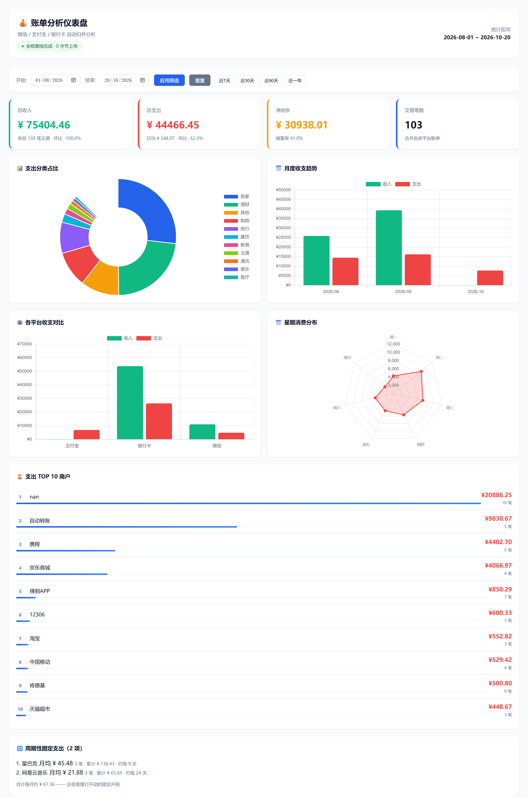

# Bill Consensus 💰

[](https://github.com/belightest/bill-consensus/actions/workflows/tests.yml)
[](https://www.python.org)
[](LICENSE)
[]()
[]()

> 本地账单合并分析工具 · 自动归并微信/支付宝/银行卡账单 · 输出可交互 HTML 仪表盘
>
> 📦 **[下载 exe 版（免装 Python）](https://github.com/belightest/bill-consensus/releases/latest)**
>
> ℹ️ 本项目大部分代码在 AI 助手辅助下生成。

## 📊 效果预览

[](docs/screenshot-full.png)

<sub>👆 点击查看完整长图（含 103 条交易明细）。截图为 `sample_bills/` 示例数据，非真实账单。</sub>

## ⚡ 30 秒快速开始

```bash
# 1. 安装依赖
pip install pandas jinja2 openpyxl

# 2. 把账单文件(微信/支付宝/银行 CSV)放进 bills/ 目录

# 3. 运行
python -m bill_consensus.main

# 4. 浏览器打开 output/dashboard.html
```

**Windows 用户**：把账单文件**拖到 `run.bat` 图标上松手**，全自动分析 + 打开仪表盘。第一次双击会自动装依赖。

## ✨ 特性

- 🔒 **100% 本地运行** — 账单数据不上传任何服务器,生成的 HTML 也是**完全离线**的(图表库已内联,断网照样看)
- 🎯 **多平台自动识别** — 微信 / 支付宝 / 任意银行卡,不用手动选格式
- 🔗 **商户名归一化** — "美团外卖" / "美团-某某店" / "美团(国贸店)" 合并成同一个商户统计
- 🔍 **重复交易检测** — 同一个文件重复丢进 bills/ 自动跳过;跨平台疑似重复会**标黄提示**(不自动删,由你核对)
- 🔁 **订阅识别** — 自动找出周期性固定支出(会员/订阅),算出每月雷打不动的开销
- 📈 **环比指标** — 本月 vs 上月收支变化,首屏直接看
- 🤖 **智能分类** — 12 个大类自动归类(餐饮/交通/购物/旅行/娱乐/医疗/教育/通讯/理财/居家/转账/充值)
- 🧠 **格式容错** — 编码自动检测(UTF-8/GBK/UTF-16)、自动跳过免责声明行、金额带逗号/货币符号都能解析
- 📦 **ZIP 直读** — 微信/支付宝导出的压缩包不用手动解压
- 📸 **截图 OCR** — 截账单图也能识别(可选,需 Tesseract)
- 📊 **交互仪表盘** — 饼图/趋势图/雷达图/TOP 10,日期筛选实时联动

## 📦 安装

```bash
# 方式 1: 源码运行
git clone https://github.com/belightest/bill-consensus.git
cd bill-consensus
pip install -r requirements.txt

# 方式 2: 直接下载 ZIP 解压,同上
```

**可选: 启用 OCR**

```bash
pip install pytesseract Pillow
# 再从 https://github.com/tesseract-ocr/tesseract/releases 装 Tesseract
```

## 📦 打包成 exe（无需 Python 运行）

不想让使用者装 Python？打成单文件 exe，双击即用：

```bash
# 1. 安装打包工具
pip install pyinstaller

# 2. 打包(约 2-5 分钟)
python -m PyInstaller bill_consensus_exe.spec --noconfirm --clean
#    Windows 用户也可以直接双击 build_exe.bat

# 3. 产物在 dist/账单合并工具.exe
```

**exe 使用方法**：
1. 把 `账单合并工具.exe` 复制到任意文件夹（如桌面）
2. 把微信/支付宝/银行账单 CSV 放进它**同级**的 `bills/` 文件夹
3. 双击 exe → 自动分析 → 自动打开浏览器看仪表盘
4. 也支持**把账单文件直接拖到 exe 图标上**松手

> 💡 exe 特性：单文件免安装、账单全程本地处理、生成 `output/dashboard.html` 后自动打开浏览器。
> ⚠️ 首次启动需解压资源，等待 3~8 秒属正常；未签名 exe 可能触发 Windows SmartScreen 提示（点"仍要运行"即可）。

## 📖 账单从哪导出?

| 平台 | 步骤 |
|---|---|
| **微信** | 我 → 服务 → 钱包 → 账单 → 右上角 ··· → **账单导出** → 用于个人对账 → 邮箱收 ZIP |
| **支付宝** | 首页 → 账单 → 右上角 ··· → **开具交易流水证明** → 用于个人 → 下载 CSV |
| **银行卡** | 网银/手机银行 → 账户明细 → 导出 CSV/Excel |

## 🚀 使用方法

### 方式 1: bills/ 目录(推荐)

把账单文件丢进 `bills/` 文件夹(没有就运行一次自动创建),然后:

```bash
python -m bill_consensus.main
```

程序自动扫描目录下所有 `.csv .xlsx .xls .zip` 文件。

### 方式 2: 指定文件

```bash
python -m bill_consensus.main 微信.zip 支付宝.csv 银行.xlsx
```

### 方式 3: Windows 拖拽

把一个或多个账单文件**拖到 `run.bat` 图标上松手**。依赖缺失会自动安装。

### 方式 4: 自定义输出

```bash
python -m bill_consensus.main -o 我的报表.html
```

## 📊 仪表盘功能

| 模块 | 说明 |
|---|---|
| **4 个指标卡** | 总收入 / 总支出 / 净结余 / 笔数 |
| **分类饼图** | 钱都花在哪了,一眼看清 |
| **月度趋势** | 收入 vs 支出按月对比 |
| **平台对比** | 微信/支付宝/银行谁花得多 |
| **星期雷达** | 周一到周日的消费习惯 |
| **TOP 10 商户** | 哪些店"偷"了你最多钱 |
| **明细表** | 搜索 + 类型筛选 + 分页 |

日期筛选与所有图表**实时联动**。

## 🖼 截图

| 图 | 内容 |
|---|---|
| [`docs/screenshot-overview.png`](docs/screenshot-overview.png) | 概览：4 指标卡 + 4 图表 + TOP 10 商户 |
| [`docs/screenshot-full.png`](docs/screenshot-full.png) | 完整长图：并含全部交易明细（1440×6543） |
| [`docs/social-preview.png`](docs/social-preview.png) | 分享封面 1280×640，用于仓库 About 的 Social preview |

> 截图使用 `sample_bills/` 示例数据（程序生成的假数据），不含任何真实账单。

## ❓ FAQ

<details>
<summary><b>Q: 报"找不到 pandas / ModuleNotFoundError"</b></summary>

```bash
pip install pandas jinja2 openpyxl
```
如果 pip 也没有: 重新安装 Python 时勾选 "Add Python to PATH" + "Install pip"。
</details>

<details>
<summary><b>Q: 解析出来 0 条交易</b></summary>

可能原因:
1. 账单是 **PDF 加密格式** → 在支付软件里选"导出为 CSV"而不是"交易证明"
2. **编码异常** → 用 Excel 打开,另存为 "CSV UTF-8" 格式
3. 列名不在支持范围 → 提 issue 附上表头截图(隐去隐私)
</details>

<details>
<summary><b>Q: 中文乱码 / Mac 上打开 CSV 乱码</b></summary>

程序自动检测 7 种编码(UTF-8/GBK/GB18030/Big5/UTF-16 等),一般不会乱码。
如果 Excel 打开乱码: 数据 → 从文本/CSV 导入 → 选 "65001: Unicode (UTF-8)"。
</details>

<details>
<summary><b>Q: 我的银行不支持?</b></summary>

支持绝大多数银行(自动匹配列名)。如果不支持:
1. 用 Excel 打开账单
2. 把表头改成: `交易日期,摘要,交易金额,余额,对方信息` 这类标准列名
3. 另存为 CSV 重试

也可以自己写解析器 — 见下文"添加新解析器"。
</details>

<details>
<summary><b>Q: 会泄露我的账单数据吗?</b></summary>

不会。程序本身不联网,生成的 HTML 也不加载任何外部资源 —— 图表库(Chart.js)已内联进 HTML,
**断网、内网或离线状态下双击打开照样能看全部图表**,更不会发送你的数据。
所有解析、统计、HTML 生成都在你电脑本地完成。
</details>

<details>
<summary><b>Q: 分类不准怎么办?</b></summary>

编辑 `bill_consensus/analyzer/classifier.py`,在 `CATEGORY_RULES` 里加关键词:

```python
("餐饮", ["塔斯汀", "蜜雪冰城", ...]),   # 在对应分类里加商户名
("宠物", ["宠物店", "猫粮"]),            # 或新增一个分类
```
</details>

## 🗂 项目结构

```
bill-consensus/
├── bill_consensus/
│   ├── main.py                 # CLI 入口
│   ├── parsers/
│   │   ├── base.py             # 统一数据模型
│   │   ├── smart_csv.py        # 智能读取(编码/表头自适应)
│   │   ├── wechat.py           # 微信
│   │   ├── alipay.py           # 支付宝
│   │   ├── bank.py             # 通用银行卡
│   │   ├── image_ocr.py        # 截图 OCR(可选)
│   │   └── factory.py          # 自动识别调度
│   ├── analyzer/
│   │   ├── classifier.py       # 智能分类(关键词长词优先)
│   │   ├── normalize.py        # 商户名归一化(去门店后缀+品牌别名)
│   │   ├── dedup.py            # 文件去重 + 跨平台疑似重复检测
│   │   ├── subscriptions.py    # 周期性固定支出识别
│   │   └── statistics.py       # 统计聚合 + 环比
│   └── templates/
│       ├── dashboard.html      # 仪表盘模板
│       └── vendor/
│           └── chart.umd.min.js # 内联的 Chart.js v4.4.0(MIT,离线用)
├── bills/                      # 👉 把你的账单放这里(自动创建,不进 git)
├── output/                     # 生成的仪表盘(自动创建,不进 git)
├── tests/
│   └── test_smoke.py           # 冒烟测试(pytest -q)
├── .github/
│   ├── workflows/tests.yml     # GitHub Actions CI
│   └── ISSUE_TEMPLATE/         # Issue 模板(bug / 新银行格式)
├── sample_bills/               # 示例账单(假数据,可直接试用)
├── docs/                       # README 截图(概览/长图/分享封面)
├── sample_data_generator.py    # 重新生成示例数据
├── run.bat                     # Windows 一键运行(双击/拖拽)
├── launcher.py                 # PyInstaller 打包入口
├── bill_consensus_exe.spec     # exe 打包配置
├── build_exe.bat               # 一键打包 exe
├── requirements.txt
├── pyproject.toml
├── LICENSE                     # MIT
└── README.md
```

## 🛠 添加新解析器

以某银行为例,新建 `parsers/mybank.py`:

```python
from .base import BaseParser, Transaction

class MyBankParser(BaseParser):
    name = "mybank"
    supported_extensions = (".csv",)

    def can_parse(self, file_path):
        # 返回 True 表示"这个文件我能处理"
        ...

    def parse(self, file_path):
        # 返回 list[Transaction]
        ...
```

然后在 `parsers/factory.py` 的 `ALL_PARSERS` 列表里注册即可。

## 📋 命令行参数

```
usage: bill-consensus [-h] [-o OUTPUT] [files ...]

positional arguments:
  files                 账单文件路径(可选,不填自动扫描 bills/)

options:
  -h, --help            show this help message and exit
  -o, --output OUTPUT   输出 HTML 路径(默认: output/dashboard.html)
```

## 🔒 隐私声明

- 所有解析与统计**在本地完成**
- 不发送任何数据到外部服务器
- 仪表盘 HTML 是纯本地文件,**不引用任何外部资源**(零 CDN 请求)
- 没有遥测、没有崩溃上报、没有调用日志

## 🤝 贡献

欢迎 Issue / PR!特别是:
- 新的银行账单格式支持
- 更多分类关键词
- OCR 准确率优化

改动前请先跑通测试:

```bash
pip install -r requirements.txt pytest
pytest -q
```

详见 [CONTRIBUTING.md](CONTRIBUTING.md)。

## 🤖 AI 辅助开发

本项目大部分代码在 AI 助手辅助下生成，经作者审阅并在真实账单上验证。

## 📄 License

[MIT](LICENSE) © 2026